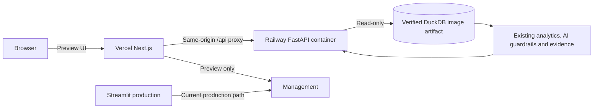
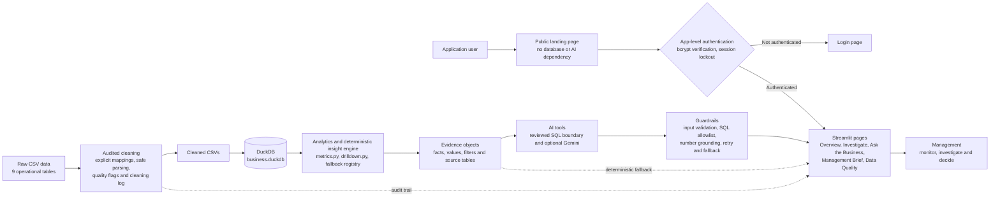
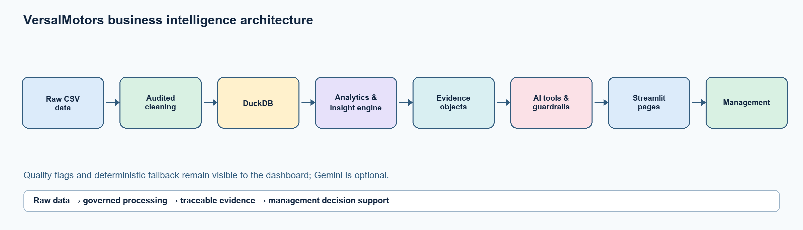
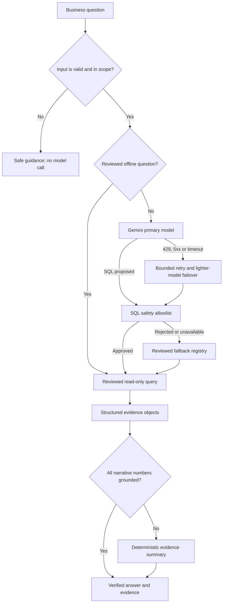
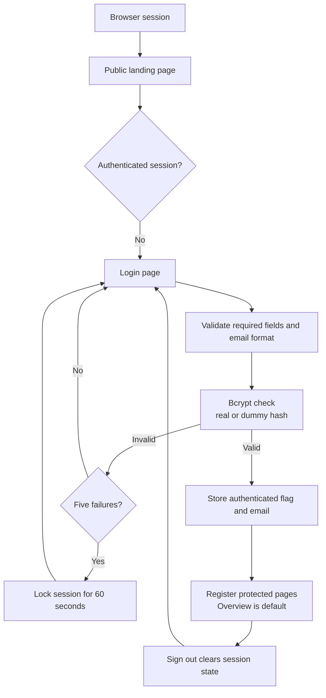

# VersalMotors Architecture

## Phase 7 parallel deployment architecture



The Phase 7 backend image builds DuckDB from tracked raw data, verifies it against the frozen parity baseline, then copies the verified file into a slim non-root runtime. Railway readiness uses `/health/ready`; Vercel forwards `/api/*` without exposing the API origin to browser code. Streamlit and its current DNS route remain unchanged until the Phase 8 approval gate.

## End-to-end architecture





## Components and responsibilities

| Layer | Implementation | Responsibility |
|---|---|---|
| Raw data | `data/raw/*.csv` | Nine reproducible operational datasets remain unchanged for audit. |
| Cleaning | `src/data/cleaning.py`, `src/data/cleaning_log.py` | Applies reviewed mappings, parses types safely, removes only exact duplicates, preserves raw companions, and flags questionable rows. |
| Build | `scripts/build_database.py` | Recreates `data/cleaned/`, `docs/cleaning_log.csv`, and the local DuckDB database. |
| Database | `data/business.duckdb` | Holds the cleaned analytical tables; it is generated locally and not committed. |
| Analytics and insights | `src/analytics/metrics.py`, `src/analytics/drilldown.py`, `src/ai/fallback.py` | Calculates management metrics, supports claim drill-down, and maps reviewed questions to deterministic evidence. |
| Evidence | Dictionaries and DataFrames returned by analytics/AI tools | Carries the fact, value, filters, and source context used to support an answer. |
| AI tools | `src/ai/gemini_client.py`, `src/database/connection.py` | Optionally interprets questions and executes only approved read-only business queries. |
| Guardrails | `src/ai/guardrails.py`, retry/fallback logic | Rejects unsafe input and SQL, verifies narrative numbers, retries transient failures, and falls back without exposing provider errors. |
| Authentication | `src/auth/auth.py`, `src/ui/auth_ui.py` | Loads bcrypt hashes from Secrets or local environment, validates credentials, applies per-session lockout, and conditionally registers protected pages. |
| Public entry and routing | `app.py`, `pages/landing.py`, `pages/login.py`, `src/ui/landing.py` | Presents the database-independent public landing, routes Sign in to Login, selects Login for anonymous protected URLs, and makes Overview the authenticated default. |
| User interface | `app.py`, protected `pages/`, `src/ui/` | Presents persistent filters, KPIs, charts, drill-downs, evidence, quality results, and PDF downloads after authentication. |
| Management | Application users | Use evidence to choose investigations and actions; AI does not make decisions for them. |

## Data and build flow

1. `scripts/generate_dataset.py` can reproduce the synthetic raw source with its fixed seed.
2. `scripts/build_database.py` calls the cleaning pipeline, writes cleaned CSVs, verifies table row counts, and loads DuckDB.
3. Pure pandas functions calculate metrics from cleaned tables. Question and drill-down tools query the same governed data.
4. Evidence objects are passed to optional AI narration and to deterministic fallback summaries.
5. The public landing and login routes are available without loading DuckDB or the AI layer; direct protected URLs select Login.
6. Successful bcrypt verification registers the protected page set with Overview as the default, then management can inspect supporting records.

## Resilient Ask the Business flow



`src/ai/gemini_client.py` owns bounded retry and model failover. `src/database/connection.py` accepts a single `SELECT` or `WITH` statement against allowlisted business tables and blocks mutation, attachment, extensions, and file-reading functions. `src/ai/guardrails.py` checks response numbers against the request evidence. Gemini is therefore an optional interpretation layer, not the source of business facts.

## Failure behavior

| Condition | User-visible result |
|---|---|
| API key absent | Reviewed deterministic query and grounded summary where supported. |
| Gemini returns `429`, `5xx`, or timeout | Bounded retry, lighter-model failover, then deterministic fallback. |
| Generated SQL is unsafe or invalid | SQL is rejected and the reviewed fallback is attempted. |
| AI narrative contains an unsupported number | Narrative is suppressed and evidence is summarized deterministically. |
| Question is unsupported by available data | The limitation is explained without guessing. |
| Filters return no rows | A no-data message is shown without a page crash. |

## Authentication boundary



The demo access layer is intentionally small and session-scoped. Credential hashes come from Streamlit Secrets or `VERSALMOTORS_AUTH_USERS_JSON` in local `.env`; plaintext passwords are never used for verification or stored in session state. An unknown email is checked against a fixed dummy bcrypt hash and receives the same response as an incorrect password. This is suitable for controlled project demonstration access; a production deployment should use a managed identity provider and Streamlit's OIDC support.

## Security and configuration

Secrets are loaded from `.env` or Streamlit secrets and are excluded from Git. Public landing and login routing runs before database bootstrap, so unauthenticated sessions cannot trigger business-page rendering. Model name, fallback models, and retry limits are configurable through `.env.example`. The database and cleaned CSVs are generated artifacts. After authentication, `app.py` calls `src/database/bootstrap.py` before protected page navigation. If DuckDB is missing or incomplete, a process lock permits one first-start build from the committed raw CSVs and the result is accepted only after all nine managed tables are present. This makes Streamlit Cloud self-starting without committing a large database. Developers can also rebuild explicitly with:

```powershell
python scripts/build_database.py
python -m streamlit run app.py
```

## Verification boundary

Formula tests use hand-calculated fixtures. Integration tests independently compare revenue, units, and gross margin with direct DuckDB SQL. Streamlit `AppTest` exercises all five pages and AI failure paths. The full stress-test record and limitations are maintained in `docs/test_log.md`.

## Presentation shell

Protected pages share Streamlit's native responsive sidebar. Its native collapse and mobile-drawer controls are visually presented as a hamburger/close control, so navigation, direct URLs, active-page state, filters, keyboard handling, and mobile backdrop behaviour remain owned by Streamlit rather than duplicated in application logic. The public landing and login routes continue to hide the sidebar control.

Inter is served locally from `static/fonts/` through Streamlit static serving in four Latin WOFF2 weights (400, 500, 600 and 700). `src/ui/typography.py` is the single source for the font stack, weights, minimum sizes, smoothing, tabular figures, and `font-display: swap`; native Streamlit is configured in `.streamlit/config.toml`, while custom HTML and Plotly consume the same token. System UI sans-serif fonts provide a non-blocking failure fallback.
